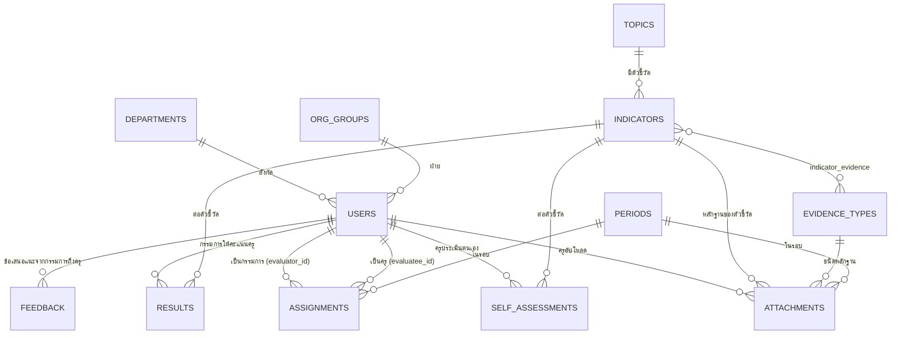
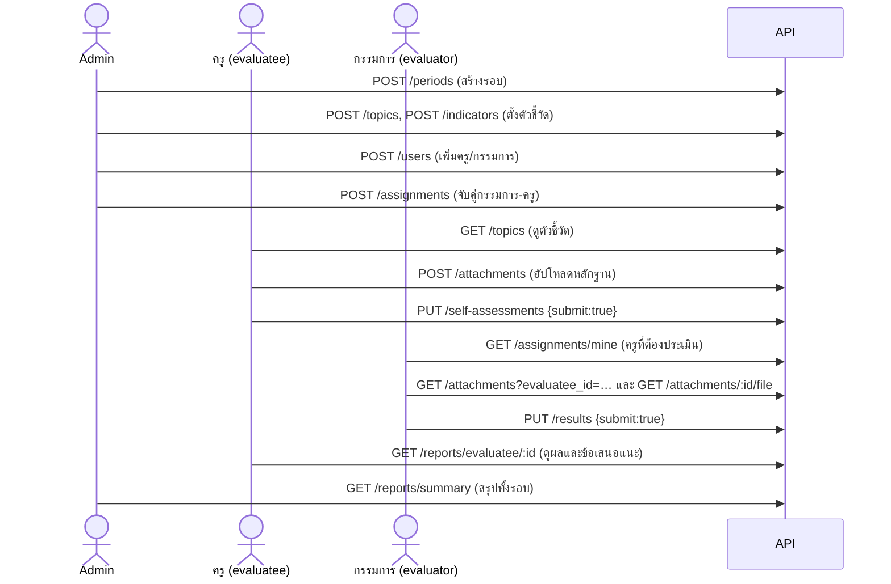

# เอกสาร API — ระบบประเมินบุคลากร (PES)

เอกสารนี้อธิบาย RESTful API ของระบบ: มีทรัพยากร (resource) อะไรบ้าง แต่ละเส้นทาง (endpoint) ทำอะไร ใครเรียกได้ และแต่ละทรัพยากรเชื่อมโยงกันอย่างไร

- **Base URL:** `http://localhost:7000/api` (หรือ `http://localhost:3000/api` ผ่านหน้าเว็บ ซึ่งจะส่งต่อไปที่ API ให้)
- **เอกสารแบบทดลองยิงได้ (Swagger):** http://localhost:7000/docs
- **โค้ดที่เกี่ยวข้อง:** เส้นทางทั้งหมดอยู่ใน [backend/routes/index.js](backend/routes/index.js) ส่วนการทำงานอยู่ใน `backend/controllers/`

---

## 1. หลักการออกแบบตาม REST

| หลักการ | ใช้ในระบบนี้อย่างไร |
|---|---|
| **ทรัพยากรเป็นคำนาม** | URL เป็นชื่อสิ่งของ เช่น `/users`, `/periods`, `/attachments` ไม่ใช่คำกริยา เช่น ~~`/getUsers`~~ |
| **ใช้ HTTP Method บอกการกระทำ** | `GET` = อ่าน, `POST` = สร้าง, `PUT` = แก้ไข/บันทึก, `DELETE` = ลบ |
| **ระบุตัวด้วย id ใน path** | `/users/5` คือผู้ใช้ id 5 |
| **กรอง/แบ่งหน้าด้วย query string** | `/users?role=evaluator&page=2&itemsPerPage=10` |
| **ทรัพยากรย่อย (sub-resource)** | `/indicators/3/evidence-types` = ชนิดหลักฐานของตัวชี้วัด 3, `/attachments/7/file` = ไฟล์จริงของหลักฐาน 7 |
| **Stateless** | server ไม่เก็บ session ทุกคำขอต้องแนบ JWT token มาเอง |
| **ตอบด้วย HTTP Status Code ที่ถูกต้อง** | ดูตารางในหัวข้อที่ 4 |
| **รูปแบบข้อมูลเป็น JSON** | ทั้งขาเข้าและขาออก ยกเว้นการอัปโหลดไฟล์ใช้ `multipart/form-data` |

### จุดที่ไม่ใช่ REST แบบเคร่งครัด (ตั้งใจออกแบบไว้)

| Endpoint | เหตุผล |
|---|---|
| `POST /auth/login` | การเข้าสู่ระบบเป็น "การกระทำ" ไม่ใช่ทรัพยากร จึงใช้ POST ตามแนวทางทั่วไป |
| `PUT /self-assessments`, `PUT /results` | บันทึกคะแนนทุกตัวชี้วัดพร้อมกันในครั้งเดียว (แทนการยิงทีละแถว) เรียกซ้ำได้ผลเท่าเดิม (idempotent) ตามความหมายของ PUT |
| `POST /self-assessments/reopen`, `POST /results/reopen` | เป็น "คำสั่ง" เปลี่ยนสถานะจาก ส่งแล้ว → ร่าง จึงเขียนเป็น action endpoint ให้อ่านเข้าใจง่าย |
| `GET /assignments/mine` | ทางลัดสำหรับกรรมการ เพื่อดูเฉพาะงานของตัวเอง |

---

## 2. การยืนยันตัวตนและสิทธิ์ (Authentication & Authorization)

1. เรียก `POST /api/auth/login` ด้วยอีเมลและรหัสผ่าน จะได้ `accessToken` (JWT อายุ 8 ชั่วโมง)
2. ทุกคำขอต่อจากนั้นแนบ header

   ```
   Authorization: Bearer <accessToken>
   ```

3. Middleware `auth()` ใน [backend/middlewares/auth.js](backend/middlewares/auth.js) ตรวจ token และบทบาท

| บทบาท (`role`) | ความหมาย |
|---|---|
| `admin` | ผู้ดูแลระบบ จัดการได้ทุกอย่าง |
| `evaluator` | กรรมการ ให้คะแนนเฉพาะครูที่ได้รับมอบหมาย |
| `evaluatee` | ครูผู้รับการประเมิน เห็นและแก้ไขเฉพาะข้อมูลของตัวเอง |

นอกจากตรวจบทบาทแล้ว ยังตรวจ **ความเป็นเจ้าของข้อมูล** ด้วย (`utils/authz.js` → `assertCanView`):
admin เห็นทุกคน, กรรมการเห็นเฉพาะครูที่จับคู่ไว้ในตาราง `assignments`, ครูเห็นเฉพาะของตัวเอง

---

## 3. รูปแบบข้อมูลที่ตอบกลับ

```jsonc
// สำเร็จ: ข้อมูลชิ้นเดียว
{ "success": true, "data": { ... } }

// สำเร็จ: รายการแบบแบ่งหน้า
{ "success": true, "items": [ ... ], "total": 42, "page": 1, "itemsPerPage": 10 }

// ผิดพลาด (ข้อความภาษาไทย)
{ "success": false, "message": "ไม่มีสิทธิ์เข้าถึงข้อมูลนี้" }
```

ข้อยกเว้น: `GET /periods/active`, `GET /indicators` และ `GET /indicators/:id/evidence-types` ตอบเป็น array ตรง ๆ (คงไว้ให้เข้ากันได้กับหน้าเว็บรุ่นแรก)

---

## 4. HTTP Status Code ที่ใช้

| Code | ความหมาย | ตัวอย่างในระบบ |
|---|---|---|
| `200 OK` | สำเร็จ | อ่าน/แก้ไข/ลบสำเร็จ |
| `201 Created` | สร้างข้อมูลใหม่สำเร็จ | `POST /users`, `POST /attachments` |
| `400 Bad Request` | คำขอผิดรูปแบบ | login ไม่ส่งอีเมล/รหัสผ่าน, ชนิดไฟล์ไม่รองรับ, ไฟล์ใหญ่เกิน 10 MB |
| `401 Unauthorized` | ยังไม่ล็อกอิน / token หมดอายุ | ไม่แนบ token, รหัสผ่านผิด |
| `403 Forbidden` | ล็อกอินแล้วแต่ไม่มีสิทธิ์ | ครูเรียก `/users`, กรรมการดูครูที่ไม่ได้รับมอบหมาย, บัญชีถูกปิด |
| `404 Not Found` | ไม่พบข้อมูล | `/users/999` |
| `409 Conflict` | ขัดกับสถานะข้อมูลปัจจุบัน | อีเมลซ้ำ, ส่งแล้วแก้ไม่ได้, ลบข้อมูลที่มีข้อมูลอื่นอ้างอิงอยู่, รอบปิดแล้ว |
| `422 Unprocessable Entity` | ข้อมูลไม่ผ่านการตรวจ | รหัสผ่านสั้นกว่า 8 ตัว, คะแนนเกินช่วง, ให้คะแนนไม่ครบตอนส่ง |
| `500 Internal Server Error` | ข้อผิดพลาดฝั่ง server | ไม่ควรเกิดขึ้นในการใช้งานปกติ |

---

## 5. ทรัพยากรและความสัมพันธ์ (Resource Relationships)



| ทรัพยากร (URL) | ตารางในฐานข้อมูล | เชื่อมกับ |
|---|---|---|
| `/users` | `users` | `departments`, `org_groups` |
| `/periods` | `evaluation_periods` | ข้อมูลการประเมินทุกอย่างผูกกับรอบ (`period_id`) |
| `/topics` | `evaluation_topics` | มีหลาย `indicators` |
| `/indicators` | `indicators` | อยู่ใต้ `topic` และใช้ได้กับหลาย `evidence-types` |
| `/evidence-types` | `evidence_types` | ผูกกับตัวชี้วัดผ่านตาราง `indicator_evidence` |
| `/assignments` | `assignments` | คู่ กรรมการ ↔ ครู ในแต่ละรอบ — **เป็นตัวกำหนดสิทธิ์** ของกรรมการ |
| `/attachments` | `attachments` | ครู + รอบ + ตัวชี้วัด + ชนิดหลักฐาน |
| `/self-assessments` | `self_assessments` | ครู + รอบ + ตัวชี้วัด |
| `/results` | `evaluation_results` + `evaluation_feedback` | กรรมการ + ครู + รอบ + ตัวชี้วัด |
| `/reports`, `/dashboard` | (คำนวณจากหลายตาราง) | รวมผลจาก attachments, self-assessments, results |

---

## 6. ลำดับการใช้งาน API ตามขั้นตอนการประเมิน



สถานะของการประเมินตนเองและผลคะแนน: `none` (ยังไม่เริ่ม) → `draft` (บันทึกร่าง แก้ได้) → `submitted` (ส่งแล้ว ล็อก) → admin `reopen` แล้วกลับเป็น `draft`

---

## 7. รายการ Endpoint ทั้งหมด

ตัวย่อสิทธิ์: **ทุกคน** = ไม่ต้องล็อกอิน · **ล็อกอิน** = ทุกบทบาท · **A** = admin · **E** = evaluator · **T** = evaluatee

### 7.1 Auth — การเข้าสู่ระบบและข้อมูลตัวเอง

| Method | Path | สิทธิ์ | คำอธิบาย |
|---|---|---|---|
| POST | `/auth/login` | ทุกคน | เข้าสู่ระบบ ได้ `accessToken` และข้อมูลผู้ใช้ |
| GET | `/auth/me` | ล็อกอิน | ข้อมูลผู้ใช้ปัจจุบัน |
| PUT | `/auth/me` | ล็อกอิน | แก้ไขชื่อตัวเอง `{ name_th }` |
| PUT | `/auth/password` | ล็อกอิน | เปลี่ยนรหัสผ่าน `{ current_password, new_password }` |

### 7.2 Users — ผู้ใช้งาน

| Method | Path | สิทธิ์ | คำอธิบาย |
|---|---|---|---|
| GET | `/users` | A | รายการผู้ใช้ — query: `page`, `itemsPerPage` (`-1` = ทั้งหมด), `search`, `role`, `status`, `department_id`, `sortBy`, `sortDesc` |
| GET | `/users/:id` | A | ดูผู้ใช้ 1 คน |
| POST | `/users` | A | เพิ่มผู้ใช้ `{ email, password, name_th, role, status?, department_id?, org_group_id? }` |
| PUT | `/users/:id` | A | แก้ไขผู้ใช้ (ส่ง `password` มาด้วย = รีเซ็ตรหัสผ่าน) |
| DELETE | `/users/:id` | A | ลบผู้ใช้ — ถ้ามีข้อมูลการประเมินแล้วได้ `409` (ให้ใช้ `status: "disabled"` แทน) |

### 7.3 Master data — ข้อมูลพื้นฐาน

| Method | Path | สิทธิ์ | คำอธิบาย |
|---|---|---|---|
| GET | `/lookups` | ล็อกอิน | แผนกวิชา ฝ่าย ชนิดหลักฐาน ประเภทวิชา (ใช้เติม dropdown) |
| POST / PUT / DELETE | `/departments`, `/departments/:id` | A | จัดการแผนกวิชา `{ code, name_th, category_id, org_group_id }` |
| POST / PUT / DELETE | `/org-groups`, `/org-groups/:id` | A | จัดการฝ่าย `{ code, name_th }` |
| POST / PUT / DELETE | `/evidence-types`, `/evidence-types/:id` | A | จัดการชนิดหลักฐาน `{ code, name_th, description? }` |

### 7.4 Periods — รอบการประเมิน

| Method | Path | สิทธิ์ | คำอธิบาย |
|---|---|---|---|
| GET | `/periods` | ล็อกอิน | ทุกรอบ (รอบที่เปิดอยู่ขึ้นก่อน) — `?active=1` เฉพาะรอบที่เปิด |
| GET | `/periods/active` | ล็อกอิน | รอบที่เปิดอยู่ (ตอบเป็น array) |
| POST | `/periods` | A | สร้างรอบ `{ code, name_th, buddhist_year, start_date, end_date, is_active }` |
| PUT | `/periods/:id` | A | แก้ไขรอบ / เปิด-ปิดรอบ |
| DELETE | `/periods/:id` | A | ลบรอบ (ได้เฉพาะรอบที่ยังไม่มีข้อมูล) |

> **หลายรายการรับ `period_id` เป็น query/body** ถ้าไม่ส่งมา ระบบจะใช้รอบที่เปิดอยู่ล่าสุด

### 7.5 Topics & Indicators — ด้านและตัวชี้วัด

| Method | Path | สิทธิ์ | คำอธิบาย |
|---|---|---|---|
| GET | `/topics` | ล็อกอิน | โครงสร้าง **ด้าน → ตัวชี้วัด → ชนิดหลักฐาน** (admin ส่ง `?all=1` เพื่อดูรายการที่ปิดใช้งานด้วย) |
| POST | `/topics` | A | เพิ่มด้าน `{ code, title_th, description?, weight, active }` |
| PUT | `/topics/:id` | A | แก้ไขด้าน |
| DELETE | `/topics/:id` | A | ลบด้าน (มีผลคะแนนแล้วได้ `409`) |
| GET | `/indicators` | ล็อกอิน | รายการตัวชี้วัดแบบแบน (array) |
| GET | `/indicators/:id/evidence-types` | ล็อกอิน | ชนิดหลักฐานที่ใช้ได้กับตัวชี้วัดนี้ + ชนิดไฟล์/ขนาดที่รับ |
| POST | `/indicators` | A | เพิ่มตัวชี้วัด `{ topic_id, code, name_th, type, weight, min_score, max_score, evidence_type_ids: [] }` |
| PUT | `/indicators/:id` | A | แก้ไขตัวชี้วัด (ส่ง `evidence_type_ids` = กำหนดชนิดหลักฐานใหม่ทั้งชุด) |
| DELETE | `/indicators/:id` | A | ลบตัวชี้วัด (มีหลักฐาน/คะแนนแล้วได้ `409`) |

`type` ของตัวชี้วัด: `score_1_4` (ให้คะแนนระดับ `min_score`–`max_score`), `yes_no` (มี/ไม่มี), `file_url` (มีหลักฐาน/ไม่มี)

### 7.6 Assignments — จับคู่กรรมการกับครู

| Method | Path | สิทธิ์ | คำอธิบาย |
|---|---|---|---|
| GET | `/assignments?period_id=` | A | ทุกคู่ในรอบ พร้อมสถานะการให้คะแนน |
| POST | `/assignments` | A | จับคู่กรรมการ 1 คนกับครูหลายคน `{ period_id, evaluator_id, evaluatee_ids: [] }` (คู่ที่มีอยู่แล้วจะข้าม) |
| DELETE | `/assignments/:id` | A | ยกเลิกคู่ — ถ้ากรรมการให้คะแนนแล้วได้ `409` ต้องส่ง `?force=1` เพื่อลบผลคะแนนด้วย |
| GET | `/assignments/mine?period_id=` | E | ครูที่ฉันต้องประเมิน + ความคืบหน้า |

### 7.7 Attachments — ไฟล์หลักฐาน

| Method | Path | สิทธิ์ | คำอธิบาย |
|---|---|---|---|
| GET | `/attachments?period_id=&evaluatee_id=&indicator_id=` | ล็อกอิน* | รายการไฟล์ (ครูไม่ต้องส่ง `evaluatee_id` จะได้ของตัวเอง) |
| POST | `/attachments` | T | อัปโหลด (`multipart/form-data`): `file`, `period_id`, `indicator_id`, `evidence_type_id`, `note?` |
| GET | `/attachments/:id/file` | ล็อกอิน* | ดาวน์โหลดไฟล์ — `?inline=1` เปิดดูในเบราว์เซอร์ |
| DELETE | `/attachments/:id` | T (ของตัวเอง), A | ลบไฟล์ (ครูลบไม่ได้เมื่อปิดรอบ หรือกรรมการส่งผลตัวชี้วัดนั้นแล้ว) |

\* ตรวจสิทธิ์ตามข้อมูล: เจ้าของ, กรรมการที่จับคู่ไว้ และ admin เท่านั้น
ไฟล์รับ PDF, PNG, JPG, WEBP, DOC(X), XLS(X), PPT(X), ZIP ไม่เกิน 10 MB และ **ไม่มี URL แบบ static** ต้องดาวน์โหลดผ่าน endpoint นี้เท่านั้น

### 7.8 Self-assessments — ประเมินตนเอง

| Method | Path | สิทธิ์ | คำอธิบาย |
|---|---|---|---|
| GET | `/self-assessments?period_id=&evaluatee_id=` | ล็อกอิน* | ผลประเมินตนเอง + สถานะ |
| PUT | `/self-assessments` | T | บันทึกทั้งชุด `{ period_id, items: [{ indicator_id, score, value_yes_no, notes }], submit }` — `submit: true` ต้องครบทุกตัวชี้วัด |
| POST | `/self-assessments/reopen` | A | เปิดให้ครูแก้ไข `{ period_id, evaluatee_id }` |

### 7.9 Results — กรรมการให้คะแนน

| Method | Path | สิทธิ์ | คำอธิบาย |
|---|---|---|---|
| GET | `/results?period_id=&evaluatee_id=&evaluator_id=` | E, A | คะแนนและข้อเสนอแนะของกรรมการ (กรรมการไม่ต้องส่ง `evaluator_id`) |
| PUT | `/results` | E | บันทึกทั้งชุด `{ period_id, evaluatee_id, items: [...], comment, submit }` |
| POST | `/results/reopen` | A | เปิดให้กรรมการแก้ไขผล `{ period_id, evaluatee_id, evaluator_id }` |

### 7.10 Reports & Dashboard — รายงาน

| Method | Path | สิทธิ์ | คำอธิบาย |
|---|---|---|---|
| GET | `/dashboard?period_id=` | ล็อกอิน | ตัวเลขสรุปตามบทบาทของผู้เรียก |
| GET | `/reports/summary?period_id=&department_id=` | A, E | สรุปผลรายบุคคล (กรรมการเห็นเฉพาะครูที่รับผิดชอบ) |
| GET | `/reports/evaluatee/:id?period_id=` | ล็อกอิน* | รายงานรายบุคคล: ทุกด้าน/ตัวชี้วัด หลักฐาน คะแนนตนเอง คะแนนกรรมการ ข้อเสนอแนะ คะแนนรวมและระดับ |

ครูจะเห็นคะแนนและข้อเสนอแนะของกรรมการ **เฉพาะเมื่อกรรมการกดส่งแล้ว**

### 7.11 System

| Method | Path | สิทธิ์ | คำอธิบาย |
|---|---|---|---|
| GET | `/health` (ไม่มี `/api`) | ทุกคน | ตรวจว่า API ทำงาน (ใช้กับ Docker healthcheck) |
| GET | `/docs` (ไม่มี `/api`) | ทุกคน | Swagger UI |

---

## 8. ตัวอย่างการเรียกใช้ (curl)

```bash
# 1) เข้าสู่ระบบ
curl -X POST http://localhost:7000/api/auth/login \
  -H "Content-Type: application/json" \
  -d '{"email":"t.it01@ccollege.ac.th","password":"Pes@2568"}'
# → { "success": true, "accessToken": "eyJhbGci...", "user": { "id": 4, "name": "ครูไอที 01", "role": "evaluatee", ... } }

TOKEN=eyJhbGci...   # นำ accessToken มาใช้ต่อ

# 2) ครูดูตัวชี้วัด
curl http://localhost:7000/api/topics -H "Authorization: Bearer $TOKEN"

# 3) ครูอัปโหลดหลักฐานของตัวชี้วัด id 1
curl -X POST http://localhost:7000/api/attachments \
  -H "Authorization: Bearer $TOKEN" \
  -F period_id=1 -F indicator_id=1 -F evidence_type_id=1 \
  -F note="แผนการสอนภาคเรียนที่ 1" -F file=@lesson-plan.pdf
# → 201 { "success": true, "data": { "id": 1, "file_name": "lesson-plan.pdf", ... } }

# 4) ครูบันทึกร่างการประเมินตนเอง
curl -X PUT http://localhost:7000/api/self-assessments \
  -H "Authorization: Bearer $TOKEN" -H "Content-Type: application/json" \
  -d '{"period_id":1,"items":[{"indicator_id":1,"score":4},{"indicator_id":4,"value_yes_no":1}],"submit":false}'
# → { "success": true, "status": "draft", "message": "บันทึกร่างเรียบร้อย" }

# 5) ลองเรียกข้อมูลที่ไม่มีสิทธิ์
curl http://localhost:7000/api/users -H "Authorization: Bearer $TOKEN"
# → 403 { "success": false, "message": "ไม่มีสิทธิ์เข้าถึงข้อมูลนี้" }
```

---

## 9. การทดสอบ API

- **อัตโนมัติ:** `cd backend && npm test` — ไฟล์ [backend/test/api.spec.js](backend/test/api.spec.js) ทดสอบทุกกลุ่ม endpoint กับฐานข้อมูลจริง รวมถึงกรณีสิทธิ์ไม่ถึง (401/403) ข้อมูลผิด (422) และสถานะขัดแย้ง (409)
- **ด้วยมือ:** เปิด http://localhost:7000/docs กด **Authorize** วาง token แล้วลองยิงแต่ละ endpoint
- **บัญชีทดสอบ** (รหัสผ่าน `Pes@2568`): `admin@ccollege.ac.th`, `eva.it@ccollege.ac.th`, `t.it01@ccollege.ac.th`
